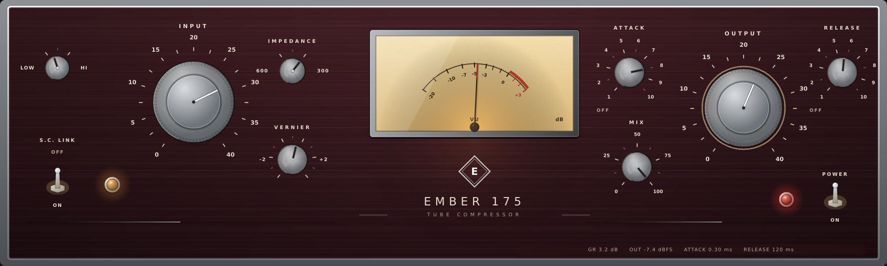

# EMBER 175-B



An independent, from-scratch VST3/AU re-creation of a **tube variable-mu limiting
amplifier in the spirit of the Universal Audio 175-B**: the same control set, the
same stepped attenuator feel, the same feedback gain-reduction behaviour (soft at
low level, brick wall when driven), plus a few modern conveniences that the
hardware never had.

EMBER 175-B is **not** a Universal Audio product and is not affiliated with,
endorsed by, or licensed from Universal Audio. All artwork, code and DSP in this
repository are original work; no Universal Audio assets, binaries, impulse
responses or measurement data are included. See [Legal](#legal) below.

---

## 1. What it models

The published 175-B specification and circuit description were used as the
calibration target. Everything below is implemented in `Source/EmberDSP.cpp`.

| Property | 175-B reference | Implementation |
| --- | --- | --- |
| Gain element | 6BC8 remote-cutoff dual triode (variable mu) | gain law applied per sample, with the triode's grid curvature and an increasing bias-dependent distortion as gain reduction rises |
| Sidechain detector | 6AL5 full-wave rectifier, feedback topology | rectifier + two-stage attack/release network that drives the gain element from the same node the audio passes through, closing the loop |
| Ratio | fixed **12:1** at the threshold of limiting, **stiffening** above it | `u * (1 - 1/R(u))` with `R(u) = 12 + 0.4·u`, i.e. 12:1 at the knee, ~16:1 at +10 dB over, >30:1 at +20 dB over |
| Attack | 100 µs … 1 ms, **clockwise = faster**, `OFF` detent | log taper, exactly 0.10–1.00 ms over the useful range, separate OFF position at the extreme |
| Release | 27 … 527 ms, clockwise = faster | log taper, 27–527 ms end to end, plus the second (slow) capacitor that gives the unit its program-dependent recovery |
| Input / Output | 0–40 dB stepped attenuators in 2 dB steps + vernier | 2 dB detents, `INPUT VERNIER` / `VERNIER` ±2 dB trims, switchable to continuous |
| I/O | 600 Ω transformer balanced, UTC transformers | transformer model with LF core saturation, second-order asymmetry and DC blocking at both ends |
| Amplifier | 12AX7 / 12BH7 gain stage | soft single-ended stage, unity gain at low level, gently louder harmonics as it is driven |
| Meter | VU / gain reduction | large amber VU with mechanical needle ballistics, switchable to a GR reading |
| Detector response | — (no sidechain filter on the original) | `LOW / HI`: the detector is fed through a 160 Hz high-pass, so bass no longer ducks the whole mix |
| Input impedance | 600 Ω transformer balanced | `IMPEDANCE 600 / 300`: a second transformer tap that adds ~1.7 dB of iron and darkens the top |
| Ratio, attack and release ranges | — | regression-tested (`Tests/DSPTests.cpp`) |

### Signal path

```
in ──► input attenuator ──► input transformer ──► 6BC8 vari-mu ──► 12AX7/12BH7
                                                   ▲                   │
                                                   │   attack/release  │
                                                   └── 6AL5 rectifier ◄┘
                                                                       │
                                                        output transformer ──► output attenuator ──► out
```

All non-linear stages run **4x oversampled** (2x above 120 kHz host rates), so a
hard-driven 175-B keeps its harmonics without folding them back into the audio
band. Measured worst-case folded harmonic at 11 kHz / −6 dBFS: below −95 dB.

### Extension controls (not on the hardware)

`MIX` (0–100 %, parallel/feel control) sits on the panel because a 175-B user
reaches for it constantly. Everything else lives in the right-click **setup
menu**, so the front panel keeps the hardware's single row of controls:

| Setup entry | Range | What it does |
| --- | --- | --- |
| Meter shows | VU / gain reduction | what the needle reads |
| Input / output taper | 2 dB detents / continuous | hardware steps, or fine automation |
| Headroom | ±12 dB | moves the operating level and the threshold together |
| G/R vernier | ±6 dB | threshold calibration trim |
| Stereo link | on / off | same as the `S.C. LINK` switch |
| Power | on / off | click-free bypass, sample-aligned with the processed path |

### Delay

The oversampling filters introduce a fixed latency of 46 samples below 120 kHz
and 31 samples above it. The exact measured delay is reported to the host through
`setLatencySamples()`, and the dry path is delayed by the same amount, so
parallel mix never combs and offline renders line up sample-exactly with the
unprocessed source (there is a test for it).

---

## 2. Front panel

The panel is drawn entirely in code (`Source/UI/PanelRenderer.cpp`) — no bitmaps,
so it stays sharp at any window size and weighs nothing. It is laid out in a
1200 × 360 design space that the editor scales uniformly into the window, so the
proportions hold from 720 px wide up to full screen.

Left to right, one single row, exactly like the reference hardware:

```
LOW/HI ─ S.C. LINK + lamp │ INPUT ⌀ · IMPEDANCE · VERNIER │ amber VU + brand │ ATTACK · OUTPUT · MIX · RELEASE · lamp + POWER
```

* dark oxblood panel with a fine brushed texture, cream silkscreen lettering and
  thin hairline rules under the groups;
* large **INPUT** and **OUTPUT** knobs in knurled brushed aluminium with a domed
  centre cap and a white pointer; smaller machined dials for the rest, each with
  its own printed tick ring and numbers;
* a big amber, back-lit VU card under glass with a mechanical needle, the red
  **+1 … +3** zone, `VU` and `dB` legends;
* the `E` monogram above `EMBER 175 / TUBE COMPRESSOR` under the meter;
* amber activity lamp next to `S.C. LINK`, red mains lamp next to `POWER`;
* a small status line (GR, output level, attack and release in real units) at the
  bottom right; hovering a knob shows that knob's own value there instead.

Knobs respond to vertical drag, the mouse wheel and double-click to default.
Right-click anywhere opens the setup menu.

`Tools/UIPreview.cpp` renders the same panel to a PNG without a display, which is
how `docs/panel-render.png` was produced (and how CI checks the layout). It draws
the knobs through the same `PanelRenderer::paintKnobComponent` entry point the
editor uses, so a placement regression shows up in CI as a visibly wrong panel. It also asserts,
for several window sizes, that every knob lands inside the window; a failed
check makes the CI render step exit non-zero.

---

## 3. Build

### GitHub Actions (recommended)

`.github/workflows/build.yml` builds everything on every push, pull request or
manual dispatch:

| Job | Output |
| --- | --- |
| `DSP tests` | fast unit/calibration tests, run on Ubuntu |
| `Windows x64 VST3` | `EMBER175-B-Windows-x64-VST3.zip` (VST3 bundle + test run) |
| `macOS universal VST3 + AU` | `EMBER175-B-macOS-universal.zip` (arm64 + x86_64, ad-hoc signed) |
| `Linux x64 VST3` | `EMBER175-B-Linux-x64.zip` + the rendered front panel PNG |

Download them from the **Actions → run → Artifacts** section.

Install locations:

* **Windows** — copy the `.vst3` folder to `C:\Program Files\Common Files\VST3`
* **macOS** — copy `EMBER 175-B.vst3` to `/Library/Audio/Plug-Ins/VST3` and the
  `.component` to `/Library/Audio/Plug-Ins/Components`
* **Linux** — copy to `~/.vst3`

### Locally

```bash
cmake -S . -B build -DCMAKE_BUILD_TYPE=Release
cmake --build build --parallel
./build/ember_dsp_tests -v          # measurement table + regression checks
```

A JUCE 8.0.6 checkout is fetched automatically by CMake. The `Standalone` target
is built as well, so you can play through the plug-in without a DAW.

Optional: render the panel headlessly (needs no audio device):

```bash
cmake -S . -B build -DEMBER_BUILD_UI_PREVIEW=ON
cmake --build build --target render_panel
```

---

## 4. Tests

`ember_dsp_tests [-v]` checks behaviour rather than taste:

1. bypass transparency and constant latency
2. unity gain below the knee
3. static transfer curve: **12:1 at the knee**, stiffening above it, output
   pinned near the threshold under hard drive
4. attack 100 µs … 1 ms and release 27 … 527 ms, measured on the gain-reduction
   trace (1 ms and 527 ms must be measurably slower than their fast
   counterparts)
5. `ATTACK = OFF` behaves as a pure tone box
6. parallel mix at 0 % is bit-exact dry
7. stereo link pulls a quiet channel down with a loud one, unlinked does not
8. folded harmonics below −40 dB, full-scale square waves finite and bounded at
   44.1 / 48 / 88.2 / 96 / 192 kHz
9. parameter taper round trips
10. throughput (≥ 3x realtime required; ~29x measured on one core)

`-v` prints the measured transfer table, THD per drive level and the timing
results, which is the handy way to see the model's numbers.

---

## 5. Known limits, and how to improve it

This is a **physically-motivated behavioural model**, not a SPICE netlist or a
measured capture of a specific chassis. What is still approximation:

* the 6BC8 gain law is a fitted curve, not a tube datasheet solve;
* transformer hysteresis is represented by an asymmetric soft saturation, not a
  JA-style hysteresis model;
* unit-to-unit variation (tube ageing, bias drift) is not modelled;
* the `LOW / HI` detector filter and the `300 Ω` input tap are plug-in
  conveniences (a 160 Hz sidechain high-pass and an extra iron stage), not
  circuits lifted from the original, which has neither.

To tighten it, capture a legally available reference (hardware you own, or a
licensed plug-in) at documented levels and sample rates, and fit the knee,
attack/release curves and harmonic profile in `Source/EmberModel.h` /
`EmberDSP.cpp`. The test suite is structured so that calibration constants can
change without breaking the invariants.

---

## 6. Analysis notes (Persian)

A Persian summary of the audit of the previous version, the new architecture and
the measurement tables is in [`docs/ANALYSIS-fa.md`](docs/ANALYSIS-fa.md).

## 7. Legal

* Independent project. "Universal Audio", "UA", "175-B", "176", "6BC8" and
  related marks belong to their owners; the name is used only to describe what
  the model is inspired by. No logo, artwork or trade dress of Universal Audio is
  reproduced here.
* JUCE is dual-licensed (AGPLv3 or commercial). If you distribute binaries built
  from this repository, comply with the AGPLv3 or hold a JUCE commercial licence.
* The DSP is original code; no third-party impulse responses or proprietary
  measurements are bundled.
